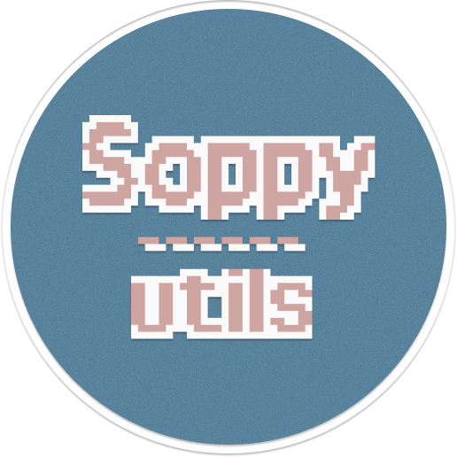

<p align="center">
  
</p>

<h1 align="center">soppy-utils</h1>
<center>


</center>


An engineering-focused collection of zsh utilities for automating common development tasks. Each tool is a zsh script; tools are installed onto `PATH` via the install script so they can be invoked as commands.

All tools are invoked through a single `spu` entry point:

```sh
spu <util> [...args]
```

Built-in tools:

| Tool | Description |
| --- | --- |
| `vscode` | Open VS Code configuration files/directories quickly |
| `license` | Generate a LICENSE text from a template |

## Overview

soppy-utils is a personal zsh development toolkit (by soppylzz) for handling miscellaneous development tasks.

Directory structure:

```
.
├── bin/            # Entry points (thin dispatchers)
├── src/            # Tool implementations and shared helpers
│   ├── usage/      # Help text, one file per tool + overview
│   ├── utils/      # Shared helpers
│   └── template/   # LICENSE templates (data, not logic)
├── scripts/        # Install/uninstall and development helpers
├── test/           # zsh test suite
│   └── general/    # Shared test primitives
└── plan/           # Requirement documents, one per demand
```

`bin/` holds only the thin `spu` launcher; all logic lives under `src/`, where each tool is one implementation plus a shared helper set. Help text is centralized in `src/usage/` and built via the `create_usager` factory, reusable helpers live in `src/utils/`, and LICENSE data lives in `src/template/`. `scripts/` contains the install/uninstall and development scripts, `test/` the zsh specs and shared primitives, and `plan/` the requirement documents (one per demand).

## Installation

Installation copies the project into `~/.local/share/soppy-utils` and symlinks `bin/spu` to `~/.local/bin/spu`.

### Option 1: git clone, then install

```sh
git clone https://github.com/soppylzz/soppy-utils.git
cd soppy-utils
./scripts/install.sh
```

The script copies the project into the install directory, creates the symlink, then removes the original clone directory.

### Option 2: one-line curl install

```sh
curl -fsSL https://raw.githubusercontent.com/soppylzz/soppy-utils/main/scripts/install.sh | zsh
```

- With `git` available: the script silently `git clone`s into the install directory.
- Without `git`: the script downloads and extracts the tarball from GitHub via `curl`.

After installation, if `~/.local/bin` is not on your `PATH`, the script prints a hint. Add this line to your `~/.zshrc`:

```sh
export PATH="$HOME/.local/bin:$PATH"
```

## Uninstall

Run the uninstall script from the install directory:

```sh
~/.local/share/soppy-utils/scripts/uninstall.sh
```

It removes the `~/.local/bin/spu` symlink and the `~/.local/share/soppy-utils` directory.

## Usage

Show the overview:

```sh
spu
# or
spu --help
```

Output:

```
Usage: spu <util> [...args]

Utils:
  vscode — open VS Code configuration files quickly
  license — generate a LICENSE text from a template
```

### spu vscode

```sh
spu vscode [OPTION]
```

| Option | Description |
| --- | --- |
| `-S`, `--snippets` | Open the VS Code snippets directory |
| `-s`, `--settings` | Open VS Code `settings.json` |
| `-k`, `--keys` | Open VS Code `keybindings.json` |
| `-h` | Show brief help |
| `--help` | Show detailed help |

```sh
spu vscode --settings
spu vscode -k
```

### spu license

```sh
spu license [OPTION]
```

| Option | Description |
| --- | --- |
| `-M`, `--mit` | Generate an MIT license |
| `-I`, `--isc` | Generate an ISC license |
| `-o`, `--output <file>` | Write the license to `<file>` instead of stdout |
| `-h` | Show brief help |
| `--help` | Show detailed help |

The author name comes from `git config user.name` (falling back to `$USER` when missing), and the year comes from `date`.

```sh
spu license --mit
spu license --isc --output LICENSE
```
